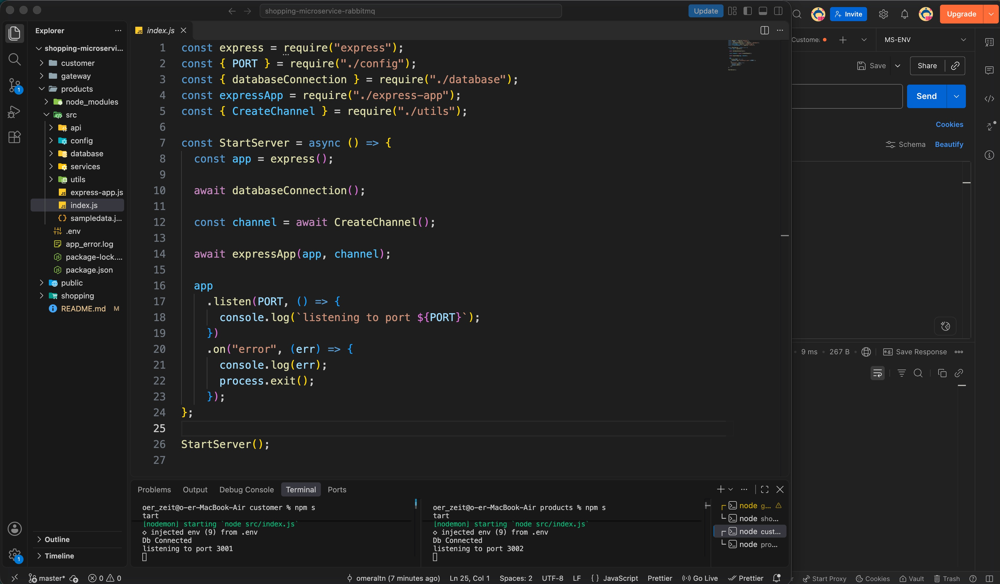

# Shopping Microservices

Monolitik alışveriş uygulamasını bağımsız **Customer**, **Products** ve **Shopping** servislerine ayıran bir mikroservis projesi. Servisler arası olay iletişimi, servislerden biri geçici olarak erişilemediğinde diğer servislerin doğrudan HTTP webhook çağrılarına bağlı kalmaması için webhook yapısından **RabbitMQ mesaj kuyruğuna** taşındı. RabbitMQ Docker üzerinde çalıştırılır.

## Servisler

- **Gateway** — İstekleri ilgili servise yönlendirir.
- **Customer** — Üyelik, profil, adres ve müşteri sepeti/istek listesi işlemleri.
- **Products** — Ürün ve kategori işlemleri; sepet ve istek listesi olaylarını yayınlar.
- **Shopping** — Sepet ve sipariş işlemleri.

## Teknolojiler

Node.js, Express, MongoDB, Mongoose, RabbitMQ (`amqplib`), API Gateway, REST API, JWT ve bcrypt.

## Görseller



## Çalıştırma

Node.js, MongoDB ve Docker üzerinde çalışan bir RabbitMQ broker'ı gereklidir. `customer`, `products` ve `shopping` klasörlerinin her birinde `.env` dosyası oluşturup aşağıdaki değişkenleri yapılandırın:

```env
PORT=
MONGODB_URI=
APP_SECRET=
RABBITMQ_URI=
EXCHANGE_NAME=
QUEUE_NAME=
SHOPPING_ROUTING_KEY=
CUSTOMER_ROUTING_KEY=
PRODUCTS_ROUTING_KEY=
```

`PORT` değerleri sırasıyla Customer için `3001`, Products için `3002`, Shopping için `3003` olmalıdır. RabbitMQ adresinin uygulama servislerinin çalıştığı ortamdan erişilebilir olduğundan emin olun; `.env` dosyalarını Git'e eklemeyin. Her servis ve gateway için ayrı bir terminal açıp proje ana klasöründen başlatın:

```bash
cd customer && npm install && npm start
cd products && npm install && npm start
cd shopping && npm install && npm start
cd gateway && npm install && npm start
```

Gateway `http://localhost:3000` adresinde çalışır ve `/customer`, `/products` ile `/shopping` isteklerini ilgili servislere yönlendirir.
