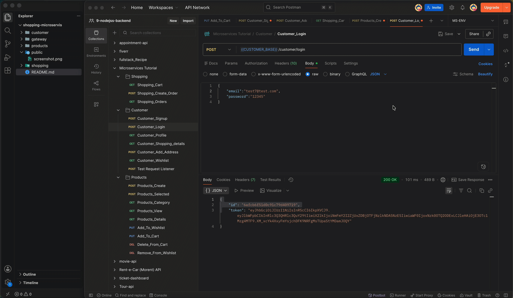

# Shopping Microservices

Monolitik yapıdaki alışveriş uygulamasını `customer`, `products` ve `shopping` servislerine ayırdığım bir çalışma. Amacım kullandığım teknikleri uygulamak ve mikroservis mimarisi konusundaki deneyimimi geliştirmekti.

## Servisler

- **Gateway** — İstekleri ilgili servise yönlendirir.
- **Customer** — Müşteri, profil ve adres işlemleri.
- **Products** — Ürün ve kategori işlemleri.
- **Shopping** — Sepet ve sipariş işlemleri.

## Kullanılan teknikler

Node.js, Express, MongoDB/Mongoose, servis başına ayrı veritabanı, API Gateway (reverse proxy), REST API, HTTP üzerinden servisler arası event/webhook bildirimleri, JWT ve bcrypt.

## Ekran Görüntü


## GIF



## Çalıştırma

Node.js ve MongoDB'nin kurulu olması gerekir. Her servisin klasöründe `.env` dosyası oluşturun:

```env
APP_SECRET=yerel-gizli-anahtar
MONGODB_URI=mongodb://localhost:27017/ms-<servis>-db
PORT=<servis-portu>
```

Portlar: `customer` 3001, `products` 3002, `shopping` 3003. `<servis>` yerine ilgili servis adını yazın. `.env` dosyalarını GitHub'a göndermeyin.

Her komutu ayrı bir terminalde, proje ana klasöründen çalıştırın:

```bash
cd customer && npm install && npm start
cd products && npm install && npm start
cd shopping && npm install && npm start
cd gateway && npm install && npm start
```

Gateway `http://localhost:3000` adresinde çalışır; istekleri `/customer`, `/products` ve `/shopping` yollarına yönlendirir.
